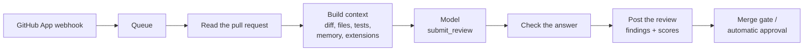

<p align="center">
  
</p>

<h1 align="center">Visto AI</h1>

<p align="center">
  <strong>An open-source, self-hosted AI reviewer for pull requests that tells you which changes still need a human.</strong>
</p>

<p align="center">
  <a href="https://github.com/visto-ai/visto-ai/actions/workflows/ci.yml"></a>
  <a href="https://github.com/visto-ai/visto-ai/releases/latest"></a>
  <a href="https://hub.docker.com/r/vistoaichecker/visto-ai"></a>
  <a href="LICENSE"></a>
</p>

<p align="center">
  <a href="#quick-start">Quick start</a> ·
  <a href="#features">Features</a> ·
  <a href="#how-it-works">How it works</a> ·
  <a href="#documentation">Documentation</a> ·
  <a href="#contributing">Contributing</a>
</p>

---

## Why Visto AI

Code used to be written by people and reviewed by people. Now AI writes much of it, and people hand the review to AI as well. Nobody is left deciding which changes still need a person.

Visto AI reviews every pull request and answers two questions:

1. **What is wrong with this change?** Bugs, security, performance and maintainability problems worth fixing. A finding that can block a merge (`[blocker]` or `[major]`) must come with a concrete failure scenario the reviewer can demonstrate. Everything else is `[minor]`. No style comments.
2. **Which parts need a human reviewer, and why?** Every changed block of code gets a score from 0% to 100%. Blocks at or above a threshold (70% by default) are listed for a person, with the lines to read and the reason.

The goal is to cut what people must review, and to show the numbers that justify it.

## Features

- **Findings you can act on.** Blocker and major findings carry a failure scenario; tests, docs, generated, vendored and lock files are scored but never get findings.
- **A human-review score for every block.** A file with ten changes, one of them a decision, sends the reviewer to that one change, not the whole file. See [The score](docs/guide/the-score.md).
- **Reviews that follow the pull request.** A new review on every push (after 180 quiet seconds, so a burst of pushes gives one review), incremental reviews of later heads, `/review` on demand, and follow-ups in the threads of its own earlier reviews. Scores hold across reviews.
- **Automatic approval** *(opt-in, per repository)*. Approves when every file is reviewed, nothing scores at or above the threshold, no major or blocker finding is open, and the base branch dismisses stale approvals. A new commit withdraws it, and an audit sample (5% by default) is sent to a person anyway.
- **A merge gate** *(opt-in)*. A required check that blocks a merge while a major or blocker finding is unanswered, with `/done`, a skip by one team, and `shadow` and `bypass` modes for rollout.
- **Inline notes** *(opt-in)*. A short comment in the diff on each block listed for a person.
- **Memory and lessons** *(opt-in)*. Learns where people stepped in on earlier pull requests, from replies that show a finding was wrong, and from reverts, and feeds that back to later reviews. Learning is by retrieval; no model is ever fine-tuned.
- **A web UI.** Overview, activity, every review, repositories, memory and settings, with password or GitHub sign-in and admin and viewer roles.
- **Extensible.** Bring your ticket system, chat tool or docs through [extension modules](docs/guide/extension-modules.md) and [MCP servers](docs/guide/mcp-tools.md).
- **Your model, your bill.** Works with [OpenRouter](https://openrouter.ai) out of the box and with any OpenAI-compatible chat-completions endpoint, with fallbacks, a second scorer and a daily spend limit.
- **Self-hosted.** One `docker compose up` with the app and Postgres. Code leaves your server only for the model endpoints, MCP servers and extensions you configure. The project runs no hosted service.
- **Measured before trusted.** Replay findings and scores offline against past pull requests, with no side effects.

## How it works



The engine is one function that reads a pull request and returns a structured review; it never writes anywhere, which is what lets the evaluation tools call it directly. Everything that comes from the pull request is wrapped as untrusted data before it reaches the model, secret files are never sent, and the model must answer through a single tool call so the result is data, not prose. The service renders the review itself. Read the full flow in [How a review runs](docs/guide/how-a-review-runs.md).

**What the score means**

| Score | Meaning | Examples |
|---|---|---|
| 0–19% | No judgement involved | Generated files, formatting, documentation text |
| 20–39% | Mechanical | A rename, new tests that mirror existing behaviour |
| 40–69% | A local behaviour change that follows an existing pattern | A bug fix inside one function |
| 70–89% | A decision | A changed business rule, data model, public contract or permission check; a new dependency; a weakened test |
| 90–100% | A decision that is costly to get wrong | Authentication, tenant isolation, an irreversible data migration, billing |

## Quick start

You need Docker, a GitHub account that can create a GitHub App, and a model API key (OpenRouter or any OpenAI-compatible endpoint).

**1. Get the code and the config files**

```bash
git clone https://github.com/visto-ai/visto-ai.git
cd visto-ai
cp env.example .env
cp config.example.yml config.local.yml
```

**2. Create the GitHub App.** This opens a page in your browser and writes the app's private key and webhook secret to a file (Node 26, nothing to install):

```bash
npm run app:create -- --webhook-url https://reviews.example.test/webhooks/github --out .env.visto-app --name "Visto AI"
```

Add `--org <your-org>` for an organisation's repositories. Copy the two lines it writes into `.env`, then delete the file. Put the printed app id in `config.local.yml` as `app.id`, and install the app on your repositories with the printed link. To create the app by hand, see [Create the GitHub App](docs/guide/create-the-github-app.md).

**3. Fill in your secrets and config.** In `.env`, set your own `POSTGRES_PASSWORD`, `DATABASE_URL` and model key. In `config.local.yml`, uncomment the `app` and `database` blocks and pick your model.

**4. Start it**

```bash
docker compose up -d --build --wait
```

The service listens on port `8080` and receives webhooks at `/webhooks/github`; put it behind HTTPS at the address you gave the app. A prebuilt image is also published as [`vistoaichecker/visto-ai`](https://hub.docker.com/r/vistoaichecker/visto-ai) for `linux/amd64` and `linux/arm64`.

**5. Watch it in dry run.** The example config starts with `dryRun: true`: every review is run and recorded, and **nothing is posted to GitHub**. Check what it would have said, then [leave dry run](docs/guide/leave-dry-run.md) by setting `dryRun: false` (or from the UI's Settings).

**6. Optional: open the UI.** Set `ui.publicUrl` in the config, restart, and create the first admin:

```bash
docker compose exec app npm run accounts -- make --config /config/config.yml --name <name> --role admin
```

Then sign in at `<publicUrl>/ui/`. See [The UI](docs/guide/the-ui.md) for GitHub sign-in and roles.

To try the service on one machine without GitHub, send it a signed sample webhook:

```bash
set -a && . ./.env && set +a
npm run dev:send-webhook -- --url http://localhost:8080/webhooks/github --secret-env WEBHOOK_SECRET --kind review
```

## Configuration

Visto AI is configured in three places:

| Where | What |
|---|---|
| `config.local.yml` | The deployment: model, limits, dry run, learning, repositories and their features. [config.example.yml](config.example.yml) documents every key, and an unknown key is an error. |
| `.env` | Secrets. The config never holds a secret; it names the variable that does, as `{ env: VARIABLE }`. See [env.example](env.example). |
| `.visto-ai.yml` | Committed by a team at the root of its repository to list paths that always need a human reviewer. It can only add protection. |

```yaml
# .visto-ai.yml
human_review:
  - db/migrate/
  - "app/**/policy.rb"
```

Once the service has started, admins can change most settings in the UI; a setting changed in the file wins at the next start. Every review costs money: `limits.spendPerDay` (50 by default, in US dollars with OpenRouter) stops new reviews for the rest of the UTC day once it is reached. See [Configuration](docs/guide/configuration.md) and [Running the service](docs/guide/running-the-service.md).

## Commands in a pull request

| Comment | What it does |
|---|---|
| `/review` | Reviews the pull request now, or re-checks the last review's head. |
| `/done` | With the merge gate on: says the pull request is ready, and asks for the review of its head that the check waits for. |
| `/ai-review-skip <reason>` | With the merge gate on: a member of the skip team lets the current commit through, with a reason. |

## Documentation

The full guide lives in [docs/guide](docs/guide) and will be published at https://visto-ai.com/docs.

| Start here | Concepts | Features |
|---|---|---|
| [Introduction](docs/guide/index.md) | [The score](docs/guide/the-score.md) | [Automatic approval](docs/guide/automatic-approval.md) |
| [Quick start](docs/guide/quick-start.md) | [How a review runs](docs/guide/how-a-review-runs.md) | [The merge gate](docs/guide/merge-gate.md) |
| [Create the GitHub App](docs/guide/create-the-github-app.md) | [Scores across reviews](docs/guide/scores-across-reviews.md) | [Inline notes](docs/guide/inline-notes.md) |
| [Leave dry run](docs/guide/leave-dry-run.md) | | [Memory](docs/guide/memory.md) |
| | | [Lessons and reverts](docs/guide/lessons-and-reverts.md) |
| | | [A second scorer](docs/guide/second-scorer.md) |
| | | [The UI](docs/guide/the-ui.md) |

| Extend | Reference | Measure |
|---|---|---|
| [Extension modules](docs/guide/extension-modules.md) | [Configuration](docs/guide/configuration.md) | [Replay](docs/guide/replay.md) |
| [The extension contract](docs/guide/extension-contract.md) | [.visto-ai.yml](docs/guide/visto-ai-yml.md) | [Backtest](docs/guide/backtest.md) |
| [MCP tools](docs/guide/mcp-tools.md) | [Running the service](docs/guide/running-the-service.md) | [Benchmark](docs/guide/benchmark.md) |
| | [Development](docs/guide/development.md) | |
| | [Repository layout](docs/guide/repository-layout.md) | |

The rules the review model follows are in [contract/review-contract.md](contract/review-contract.md). Benchmark write-ups are in [docs/benchmarks](docs/benchmarks).

## Measuring it on your own history

Before you trust the reviewer with your merges, run it against pull requests you already merged. The eval commands call the same engine as the service and post nothing:

- **[Replay](docs/guide/replay.md)** reruns the findings on past pull requests and compares them with what reviewers actually said.
- **[Backtest](docs/guide/backtest.md)** measures the score against where people actually commented.
- **[Benchmark](docs/guide/benchmark.md)** runs the reviewer on a public benchmark.

## Status

Visto AI is in active development and released as `0.x`. Every feature above is part of the current release. A release is cut each time `dev` is merged into `main`, versioned from the commit messages and published with notes on the [releases page](https://github.com/visto-ai/visto-ai/releases) and as a Docker image. Until `1.0`, a breaking change bumps the minor version, so read the release notes before you upgrade.

## Development

Requires Node 26 or later. TypeScript runs directly; there is no build step for the service.

```bash
npm ci
npm test
npm run typecheck
npm run lint
```

Tests never reach the network: the test setup blocks sockets and `fetch` and clears credential variables. The web UI is its own package in `ui/` (React, TypeScript, Vite, Tailwind CSS):

```bash
npm --prefix ui ci
npm --prefix ui test
npm --prefix ui run build
```

See [Development](docs/guide/development.md) and [Repository layout](docs/guide/repository-layout.md).

## Contributing

Contributions are welcome: bug reports, documentation fixes, and code.

- **Open an issue** before a large change, so we can agree on the approach first.
- **Branch from `dev` and open your pull request against `dev`.** `main` holds releases only.
- **Use [Conventional Commits](https://www.conventionalcommits.org)** for commit messages and the pull request title, for example `fix(gate): keep the check queued after a push`. CI checks this, and release notes are built from it.
- **Keep CI green.** Run the checks in [Development](#development) before you push, and add tests with your change.

## Security

Please do not report a security issue in a public issue. Use GitHub's [private vulnerability reporting](https://github.com/visto-ai/visto-ai/security/advisories/new) instead, and we will reply there.

## Licence

[Apache-2.0](LICENSE). Copyright 2026 The Visto AI authors; see [NOTICE](NOTICE).
